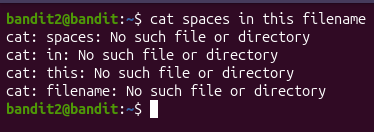
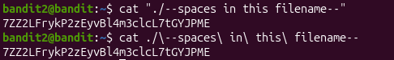

# Username

bandit2

# Bandit 2 Password 

PK8fYLZg2hnHSz83plBL1iEPKdD3QToB

# The password for the next level is stored in a file called --spaces in this filename-- located in the home directory

In this level we need to be careful because of the filename and this can be very tricky.

As we can see we cannot open the file and this is why its recommended not to put spaces in your filename/directories. However there are a couple of methods we could use to reference filenames with spaces in them. 

# Solutions For This Level

As we can see we found to solution for this level, in the first method we wrap the file name on quotes, in this case double quotes. This ensures that Linux will interpret everything inside the quotes as a since object. 

In the second method we add backslahes before every space in the filename, which lets Linux know that the space is not the start of a new filename.
