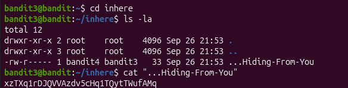

# Username

bandit3

# Bandit 3 Password
7ZZ2LFrykP2zEyvBl4m3clcL7tGYJPME

# The password for the next level is stored in a hidden file in the inhere directory.

So now we need to find a command that can show us hidden files. But since its inside a directory we need to enter that directory first.

And for that we use the command cd as you can see in the image. After that we will use the command # ls # with the  # -la # flag.
The current directory is denoted as . and because its name starts with a dot, it is hidden by default. The same goes for the directory above the current one which is ..
